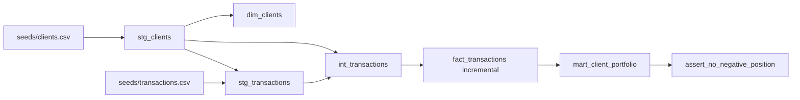

# Clube do Valor — Teste técnico de Engenharia de Dados

Projeto **dbt + DuckDB**: dois CSVs originais, seis modelos em três camadas, documentação e testes que expõem os problemas intencionais da fonte. A avaliação do núcleo é inteiramente local: **não exige site, Supabase, login, credenciais ou servidor**. Python **3.12** é a versão validada; dependências diretas estão fixadas em `requirements.txt` e o ambiente completo em `requirements-lock.txt`.

Comece pelos [comandos de reprodução](#reprodução). O resultado esperado é `seed` 2/2, `run` 6/6 e `test` **71 PASS / 6 WARN / 0 ERROR**, exit 0. Os alertas são intencionais e visíveis; o [modo estrito](#qualidade-e-ambiguidade-do-enunciado) termina com exit 1. A [matriz de requisitos e revisão da entrega](docs/qa/delivery-review.md) liga cada exigência do enunciado às evidências.

Documentação da entrega: [índice e pendências](docs/entrega/README.md), [enunciado original](docs/entrega/enunciado.html), [auditoria da fonte](docs/qa/auditoria.md), [validação independente](docs/qa/validacao.md), [roteiro v2](presentation/v2/ROTEIRO.md) e [relatório histórico do vídeo v1](presentation/ENTREGA.md).

Código: [repositório](https://github.com/Artjosh/clube-do-valor-dbt). A release v1.1.0 reúne as duas versões finais da apresentação. Veja [arquivos, links e estado da entrega](docs/entrega/README.md#apresentação-e-passos-externos).

Vídeo obrigatório v2: **231 segundos (3min51s)**, 1920×1080, 30 fps, narração sintética em português. Downloads da v1.1.0: [versão narrada](https://github.com/Artjosh/clube-do-valor-dbt/releases/download/v1.1.0/apresentacao-cdv-v2-narrada.mp4) e [versão sem áudio](https://github.com/Artjosh/clube-do-valor-dbt/releases/download/v1.1.0/apresentacao-cdv-v2-sem-audio.mp4). A silenciosa tem a mesma duração e nenhum stream de áudio, para gravação pessoal com o [roteiro/timecodes](presentation/v2/ROTEIRO.md) e as [instruções de facecam](presentation/v2/README.md). Os arquivos locais ficam em `presentation/v2/renders/`; os MP4s são assets da release, não arquivos Git. A v1 de 124s foi preservada. Recomenda-se assistir antes do envio; metadados técnicos não substituem revisão humana da fala.

## Reprodução

Execute a partir da raiz do projeto. Instale as dependências com internet; após a instalação o pipeline usa somente arquivos locais. Não é necessário `dbt deps`.

Windows PowerShell, sem necessidade de ativar scripts:

```powershell
py -3.12 -m venv .venv
.\.venv\Scripts\python.exe -m pip install -r requirements-lock.txt
.\.venv\Scripts\dbt.exe seed --profiles-dir .
.\.venv\Scripts\dbt.exe run --profiles-dir .
.\.venv\Scripts\dbt.exe test --profiles-dir .
.\.venv\Scripts\dbt.exe docs generate --profiles-dir .
```

POSIX (Linux/macOS):

```sh
python3.12 -m venv .venv
. .venv/bin/activate
python -m pip install -r requirements-lock.txt
dbt seed --profiles-dir .
dbt run --profiles-dir .
dbt test --profiles-dir .
dbt docs generate --profiles-dir .
```

O arquivo `profiles.yml` está na raiz. O banco padrão é `clube_do_valor.duckdb`, schema `main`; `DBT_DUCKDB_PATH` permite outro caminho. Execute um processo escritor por vez e feche conexões antes de rodar dbt. `target/`, `logs/`, `.venv/` e os bancos locais são ignorados pelo Git. Com o ambiente ativado, os comandos são simplesmente `dbt seed`, `dbt run`, `dbt test` na raiz (o profile local é descoberto pelo dbt); os exemplos usam `--profiles-dir .` explicitamente para evitar ambiguidade.

## Modelagem e dados

O diagrama abaixo representa as dependências reais (`ref`). A canonização de clientes precede a validação de transações; a dimensão mantém também os clientes sem negociação.



Para cada par cliente/ativo: `net_quantity = SUM(BUY.quantity) − SUM(SELL.quantity)` e `net_financial_amount = SUM(BUY.quantity × unit_price) − SUM(SELL.quantity × unit_price)`. O teste singular seleciona `net_quantity < 0` no mesmo grão.

| Modelo | Grão e regra | Linhas no resultado-base |
|---|---|---:|
| `stg_clients` | Um cadastro por `client_id`, escolhendo o mais completo | 25 |
| `stg_transactions` | Uma transação válida por ID, com tipos e filtros | 98 |
| `int_transactions` | Join com cliente canônico e cálculo de quantidades/valores com sinal | 98 |
| `dim_clients` | Cadastro atual, incluindo clientes sem negociação | 25 |
| `fact_transactions` | Fato incremental, chave `transaction_id` | 98 |
| `mart_client_portfolio` | Cliente/ativo com ao menos uma transação válida | 55 |

As seeds conservam **100 transações e 27 cadastros**, incluindo todos os defeitos. `scripts/extract_seeds.py` extrai os arrays JSON literais do HTML UTF-8, preservando os bytes que o download geraria (CRLF, sem newline extra). Os CSVs e uma cópia byte a byte do HTML estão incluídos; o pipeline não depende do caminho original na máquina do autor. A [origem e o SHA-256](docs/entrega/README.md#origem-do-enunciado) permitem conferir a proveniência. Reextração opcional (reescreve as seeds; não é necessária para executar ou avaliar):

```sh
python scripts/extract_seeds.py docs/entrega/enunciado.html
```

Para auditar os CSVs contra o HTML incluído, sem sobrescrever seeds ou oracle, execute da raiz (com Python disponível):

```sh
python scripts/qa/audit_source.py docs/entrega/enunciado.html --seeds-dir seeds
```

Os caminhos absolutos na auditoria histórica registram a execução original; para novas execuções use `docs/entrega/enunciado.html`. A validação independente e suas evidências estão em [docs/qa/validacao.md](docs/qa/validacao.md) e [docs/qa/validation_results.json](docs/qa/validation_results.json).

O staging usa `try_cast`, normaliza textos e exclui ID/cliente/ativo ausentes, operações fora de BUY/SELL, quantidade/preço não positivos, datas inválidas e clientes sem cadastro. A auditoria `audit_invalid_transactions` usa os mesmos macros de tipagem e validação, retornando os rejeitados com motivo; os valores brutos permanecem nas seeds. No dataset original são **T021** (cliente ausente) e **T037** (quantidade negativa).

`stg_clients` prioriza a quantidade de campos preenchidos e desempata por data mais antiga, nome, cidade e UF em ordem crescente, com nulos por último. Assim C6 conserva Brasília; as cópias idênticas de C1 produzem o mesmo resultado qualquer que seja a ordem física. Isso é uma regra determinística de canonização, sem inventar um timestamp de atualização. A unicidade da seed continua alertando sobre C1 e C6.

**T035 e T036 são preservadas**: possuem IDs distintos apesar do mesmo payload. Um teste aponta a suspeita; deduplicá-las exigiria confirmação de negócio. As macros `clean_text` e `typed_transactions`/`valid_transaction` são de fato reutilizadas em modelos e na auditoria.

`quantity` e `unit_price` são `decimal(18,4)`, os valores financeiros `decimal(28,8)` e as datas `date`. O portfólio soma BUY menos SELL em quantidade e valor financeiro. **`net_financial_amount` não é lucro, saldo de caixa nem valor de mercado**: não existem cotações atuais, custos, taxas, moeda declarada ou saldo inicial no enunciado. Clientes sem transações continuam na dimensão, mas não geram posições artificiais. O histórico fornecido termina em 10/08/2024.

## Qualidade e ambiguidade do enunciado

O enunciado exige simultaneamente execução sem erro e detecção de problemas intencionais. A interpretação adotada é transparente: **invariantes dos modelos são `error`**, enquanto somente seis testes diagnósticos são `warn`, com `store_failures: true`. `dbt test` termina com código 0 e alertas visíveis; não significa fonte sem problemas. Todos os modelos e todas as colunas, inclusive seeds, estão descritos em `models/schema.yml`, com `not_null`, `unique`, `accepted_values` e relacionamentos onde aplicáveis.

| Alerta | Resultados no conjunto original |
|---|---|
| `assert_no_negative_position` | 6 posições negativas reais |
| `audit_invalid_transactions` | T021 e T037 |
| `audit_duplicate_transaction_payload` | T035 e T036 |
| `unique_clients_client_id` | 2 IDs duplicados: C1 e C6 |
| `not_null_clients_city` | 1 cadastro incompleto: C6 |
| `not_null_transactions_client_id` | 1 transação: T021 |

| Cliente | Ativo | Quantidade líquida | Valor financeiro líquido |
|---|---|---:|---:|
| C1 | BBDC4 | -50 | -800,00 |
| C3 | WEGE3 | -30 | -1.194,00 |
| C5 | BBDC4 | -400 | -6.140,00 |
| C6 | ITUB4 | -50 | -1.445,00 |
| C7 | WEGE3 | -60 | -2.430,00 |
| C8 | VALE3 | -30 | -2.130,00 |

Não se infere fraude ou erro definitivo das posições negativas: falta histórico anterior e informação sobre posições vendidas. O singular retorna essas linhas sem corrigi-las ou escondê-las. Consulte evidências persistidas pelo dbt:

```sql
select * from main_dbt_test__audit.assert_no_negative_position;
select * from main_dbt_test__audit.audit_invalid_transactions;
select * from main_dbt_test__audit.audit_duplicate_transaction_payload;
```

As tabelas de auditoria são substituídas a cada teste, não são histórico imutável. Para fiscalização estrita, use (com o ambiente ativado):

```sh
dbt --warn-error test --profiles-dir .
```

**Resultado esperado: código 1 e seis testes falhando** com os dados originais. `--warn-error` também promove outros avisos do dbt; não é configuração padrão nem transforma invariantes em avisos. Referência: [severidade oficial do dbt](https://docs.getdbt.com/reference/resource-configs/severity).

## Incremental: contrato e limites

`fact_transactions` usa `delete+insert`, suportado pelo [adaptador dbt-duckdb](https://github.com/duckdb/dbt-duckdb), e chave única `transaction_id`. `transaction_date` controla a leitura: data maior ou igual a `max(transaction_date)` já carregada menos **30 dias**, inclusive. A primeira execução e o `--full-refresh` leem todo o staging; um alvo vazio também recarrega o histórico. A janela é relativa ao máximo do banco, não ao relógio atual. Pode ser alterada com `--vars '{"incremental_lookback_days": 90}'` (no PowerShell, prefira um arquivo YAML ou confirme a passagem de aspas da sua versão do shell).

Reexecutar a mesma entrada é idempotente. Novos fatos e correções cuja data atual esteja na janela substituem o ID, sem duplicá-lo. IDs iguais na fonte continuam sendo erro de unicidade, sem regra silenciosa de desempate. Atualizações históricas além da janela, transações atrasadas além dela, exclusões, correções que tornem registros inválidos ou mudem sua data para fora da janela exigem reconstrução. A data de negócio não é CDC: não há `updated_at`, tombstone ou log de alterações. Uma data futura incorreta também pode avançar o watermark; revisar a fonte e reconstruir é necessário. O script funcional testa explicitamente essas limitações.

```sh
dbt seed --full-refresh --profiles-dir .
dbt run --full-refresh --profiles-dir .
dbt test --profiles-dir .
```

Execute `dbt run` completo para atualizar os marts após o fato; executar apenas o fato não atualiza automaticamente os descendentes. Quando necessário, use `dbt run --select fact_transactions+ --profiles-dir .`.

## Verificação funcional e documentação

```powershell
.\.venv\Scripts\python.exe scripts/verify_pipeline.py
```

```sh
python scripts/verify_pipeline.py
```

A suíte copia somente o projeto dbt para uma pasta temporária, usa banco isolado e não modifica os CSVs nem o banco principal. Verifica contagens, rejeições, preferência de cadastro, manutenção de T035/T036, posições negativas, idempotência, chegada nova/atrasada, correção na janela, limites fora dela, exclusão/invalidação e recuperação por full-refresh. Executa ainda o modo estrito esperando falha e gera o catálogo. O resumo durável está em `scripts/validation_results.json`; artefatos completos por comando ficam em `target/evidence/`. Nenhum typecheck ou linter é executado.

Execução validada em Windows/Python 3.12.10: `seed` 2/2, `run` 6/6, `test` **71 PASS / 6 WARN / 0 ERROR**, modo estrito **71 PASS / 6 FAIL** (código 1 esperado), catálogo gerado e **17 verificações funcionais aprovadas**. `pip check` não encontrou incompatibilidades. As 55 linhas do portfólio também foram comparadas com o oracle independente de QA: quantidade líquida total 10.900 e valor financeiro líquido total 215.915,00. Os comandos POSIX são fornecidos para reprodução, mas não foram executados nesta máquina.

`dbt docs generate --profiles-dir .` gera `target/index.html`, `manifest.json` e `catalog.json`. Para visualizar localmente, execute `dbt docs serve --profiles-dir . --no-browser` e abra a URL indicada num navegador externo. No PowerShell sem ativar o ambiente, use `.\.venv\Scripts\dbt.exe docs serve --profiles-dir . --no-browser`. O catálogo inclui o DAG navegável. Para o vídeo obrigatório de até cinco minutos, consulte o [índice da entrega](docs/entrega/README.md) e o [roteiro v2](presentation/v2/ROTEIRO.md); publicação e envio são etapas externas ao pipeline.

A revisão atual executou novamente seed/run/test/docs e modo estrito em `target/delivery-check/`, com banco novo e runtime já instalado, reconciliando as 55 posições com Decimal e verificando os hashes dos 23 arquivos protegidos antes/depois. Comando opcional: `.\.venv\Scripts\python.exe -B scripts/qa/delivery_check.py` (POSIX: `python scripts/qa/delivery_check.py` no ambiente ativado). Evidências: [relatório](docs/qa/delivery-review.md) e [resultado estruturado](scripts/qa/delivery_results.json). Isso não alega nova instalação de dependências nem execução POSIX.

## Extensão opcional: dashboard

[Dashboard](https://clube-do-valor-intelligence.artjosh.chatgpt.site) · [execução do site](web/README.md) · [arquitetura](docs/web-architecture.md) · [autenticação](docs/web-auth.md) · [estado da publicação](docs/web-publication.md) · [QA de acesso privado](docs/qa/web_access_review.md). Essa extensão não é pré-requisito para os comandos dbt nem substitui a documentação do teste.

Após a entrega v1.0.0, a extensão web foi implementada em `web/`: Vinext com rotas server-side, dashboard Copper/Silver/Gold e login por e-mail/OTP, com alternativa entre PC/celular. Os níveis são profundidades de análise, sem cobrança. O pipeline e o banco DuckDB originais foram preservados; o site consome um snapshot analítico derivado, enquanto PostgreSQL Supabase dedicado contém identidade, desafios, sessões e permissões. Os testes do dashboard têm evidências separadas em `docs/qa/web*`. Estado informado pelo coordenador nesta revisão: SMTP Brevo e dois templates configurados e relidos sem diferenças, login publicado habilitado (`AUTH_ENABLED=true`, env revision 4), primeiro recebimento de e-mail confirmado. Ajustes de OTP de seis dígitos e HTML do e-mail seguem em tarefa separada; esta QA do core não certifica essa jornada final, que não é pré-requisito para avaliar dbt. Consulte o [estado operacional](docs/web-publication.md) e o [guia Brevo](docs/brevo-activation.md) para atualizações.
