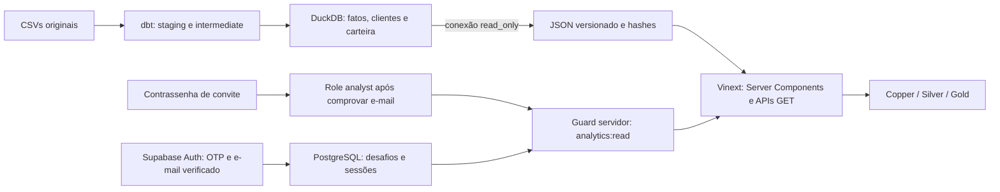

# Arquitetura do observatório

O dashboard estende a entrega técnica sem alterar o dbt, os dados ou acrescentar cotações. O dataset é o exemplo do enunciado.

| Componente | Responsabilidade | Escrita |
|---|---|---|
| dbt + DuckDB | Transformação e auditoria analítica | Somente o pipeline existente, não reexecutado na extensão |
| `scripts/export_dashboard.py` | Snapshot verificável | Apenas JSON; DuckDB `read_only=True` |
| Vinext / Vite / React | Interface e backend App Router | Nenhuma escrita analítica |
| `web/lib/analytics.ts` | Filtrar, agregar e exportar CSV | Nenhuma; função sobre snapshot |
| Supabase Auth | Verificar identidade | Projeto dedicado |
| PostgreSQL | Desafios, sessões, convites, role de acesso e limites | Schema privado; RPC somente servidor |
| Sites / Cloudflare Workers | Hospedar e guardar secrets | Artefatos e variáveis do site |

O backend fica nas rotas do Vinext, sem outro servidor HTTP. Não há DuckDB no navegador ou driver no Worker. A exportação permite hospedagem edge, evita conexões analíticas concorrentes e registra exatamente o conteúdo publicado. Novo snapshot exige exportar e republicar; a interface não promete tempo real.

## Níveis

- **Copper:** saldo financeiro, volume, atividade, série temporal e distribuição por ativo.
- **Silver:** carteiras, transações e clientes; filtros, pesquisa, ordenação, paginação, detalhe e CSV do recorte.
- **Gold:** posições negativas, rejeições, conteúdo coincidente entre IDs, alertas documentados, linhagem e hashes.

Todos são gratuitos, acessíveis à role `analyst`; os três níveis não são papéis diferentes de autorização. A entrada da hospedagem é aberta, mas o servidor exige sessão e role para qualquer dado. O primeiro login verificado cria conta sem acesso. O botão Contrassenha permite reivindicar convite e vincular a role ao e-mail comprovado; a concessão não ocorre ao simplesmente informar o endereço.

## Semântica e precisão

Decimais saem do DuckDB como strings e são agregados em `BigInt` com escala de oito casas; a conversão numérica ocorre na resposta JSON. CSV de fatos e carteiras conserva precisão. A interface formata BRL com duas casas. Saldo é compras menos vendas no recorte, sem saldo anterior, cotações, patrimônio, lucro ou rentabilidade.

Filtros de data/operação recalculam o saldo do recorte. Posições negativas seguem filtros; alertas de origem representam o dataset completo. Os 71 PASS e 6 WARN são evidência histórica, não execução ao abrir a página. `sourceHash` é SHA-256 do banco de origem; seeds e HTML têm hashes separados.

## Identidade

O PC inicia um desafio de cinco minutos. A pessoa informa o OTP recebido por e-mail, ou abre o link no celular e confirma o código do PC. GET não consome o token. O servidor verifica a identidade e estabelece a sessão HttpOnly; o caminho entre dispositivos usa polling. O PostgreSQL usa lock, hashes de segredos, sessão única e revogação.

Autenticação e autorização são distintas. Login comum não cria role. A contrassenha reivindicada no navegador, vinculada ao desafio e e-mail verificado, concede `analyst`, que habilita `analytics:read`. A role fica em tabela privada e é conferida em cada leitura. Guard SSR/RSC ocorre antes de importar o snapshot; APIs analíticas e exportações aplicam o mesmo controle. Estado React, cookie inventado, JWT enviado pelo visitante ou `user_metadata` não concedem permissão. Respostas privadas usam no-store. Revogar o acesso deve bloquear a próxima consulta.

Projeto gratuito dedicado `clube-do-valor-intelligence`, ref `igucxanapndewkbtarfn`, região `sa-east-1`. Nenhum projeto anterior foi reutilizado/excluído. Nenhum dado analítico em PostgreSQL. O Supabase Free recusou os templates com o provedor de e-mail padrão: SMTP próprio é necessário. Nenhum upgrade contratado. `AUTH_ENABLED=false` bloqueia login e dados até a configuração real do Brevo. Veja [autenticação](web-auth.md) e [ativação](brevo-activation.md) para testes e limites. Secrets ficam fora de Git, logs, screenshots e documentação.

O Worker foi configurado para preservar logs de aplicação, sem logs automáticos de URL de requisição ou traces, porque o callback contém token descartável na query string. O código não deve registrar códigos, tokens, cookies ou corpos de autenticação. Referência: [Workers Logs](https://developers.cloudflare.com/workers/observability/logs/workers-logs/). Esse controle não é uma afirmação sobre toda a retenção interna dos provedores.
